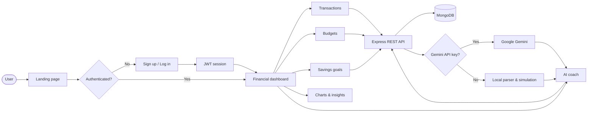
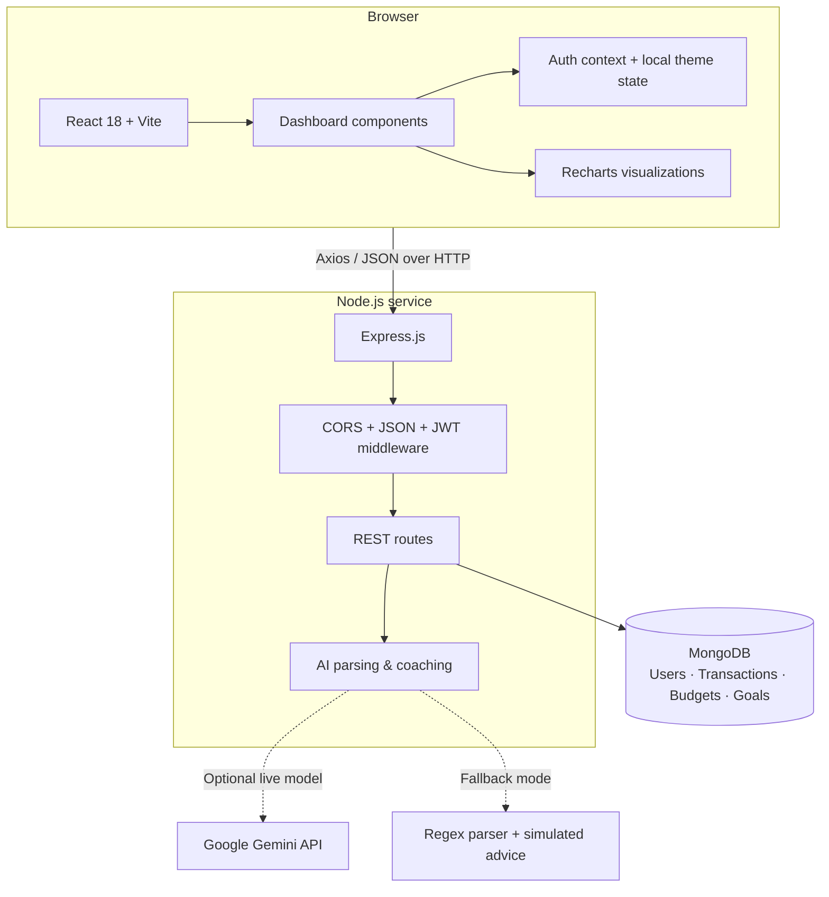

# SmartWealth AI

<p align="center">
  <strong>Track smarter. Budget better. Build wealth with confidence.</strong>
</p>

<p align="center">
  <a href="https://smartwealth-expense-tracker-ai.vercel.app/">
    
  </a>
  <a href="https://github.com/Santoshray-27/Expense-Tracker-Ai">
    
  </a>
  
</p>

SmartWealth AI is a full-stack personal finance workspace for recording income and expenses, managing monthly budgets, tracking savings goals, visualizing spending patterns, and receiving personalized financial coaching.

> **Live application:** [smartwealth-expense-tracker-ai.vercel.app](https://smartwealth-expense-tracker-ai.vercel.app/)

## ✨ Highlights

- **Secure accounts** with JWT authentication and bcrypt password hashing.
- **Fast transaction entry** with manual forms or conversational natural-language parsing.
- **Budget guardrails** with category limits and visual spending thresholds.
- **Savings goals** with target amounts, current progress, and deadlines.
- **Interactive analytics** using responsive Recharts pie and bar charts.
- **AI financial coaching** powered by Google Gemini with a local simulation fallback.
- **Light and dark themes** with a polished OKLCH-based design system.
- **Production-ready monorepo** where Express can serve the compiled React application.

## 🧭 How It Works



## 🏗️ Architecture



### Request lifecycle

1. The React client collects an action from the dashboard.
2. Axios sends a JSON request to an Express route.
3. Protected routes validate the JWT and scope data to the current user.
4. Mongoose reads or updates MongoDB documents.
5. The API returns structured JSON for the dashboard, charts, or AI advisor.
6. If Gemini is unavailable, local parsing and simulation logic keep the core experience usable.

## 🧰 Technology Stack

| Layer | Technologies |
| --- | --- |
| **Frontend** |  React 18 ·  Vite ·  Tailwind CSS · Framer Motion · Lucide React |
| **Charts & UI** | Recharts · OKLCH design tokens · Responsive CSS |
| **Backend** |  Node.js ·  Express.js · CORS |
| **Database** |  MongoDB · Mongoose |
| **Authentication** | JSON Web Tokens · bcryptjs |
| **Artificial intelligence** |  Google Gemini API · Local regex simulation fallback |
| **Tooling & deployment** | npm · Concurrently · Vercel-compatible client build · Render/Railway/Heroku-compatible server |

## 📁 Project Structure

```text
.
├── client/                    # React + Vite frontend
│   └── src/
│       ├── components/        # Dashboard, forms, charts, navigation, AI advisor
│       ├── context/           # Authentication context and API session state
│       ├── App.jsx            # App shell, auth gate, and theme provider
│       └── index.css          # Global design tokens and theme styles
├── server/                    # Node.js + Express backend
│   └── src/
│       ├── config/             # MongoDB and Gemini initialization
│       ├── middleware/         # JWT protection middleware
│       ├── models/             # User, transaction, budget, and goal schemas
│       ├── routes/             # Auth, transaction, budget, goal, and AI APIs
│       └── index.js            # API bootstrap and production static serving
├── package.json               # Monorepo scripts
└── README.md
```

## 🚀 Getting Started

### Prerequisites

- [Node.js](https://nodejs.org/) 18 or newer
- [MongoDB](https://www.mongodb.com/) locally or a MongoDB Atlas cluster
- A Google Gemini API key is optional; without it, AI features use simulation mode

### 1. Install dependencies

```bash
npm run install-all
```

### 2. Configure the server

Create `server/.env`:

```ini
PORT=5000
MONGO_URI=mongodb://127.0.0.1:27017/expense-tracker
JWT_SECRET=replace-with-a-long-random-secret
GEMINI_API_KEY=your-gemini-api-key
# Optional: GEMINI_MODEL=models/gemini-2.5-flash
# Optional in production: CLIENT_URL=https://your-client-domain.example
```

Never commit `.env` files or real credentials.

### 3. Start development mode

```bash
npm run dev
```

- Frontend: [http://localhost:3000](http://localhost:3000)
- API: [http://localhost:5000](http://localhost:5000)

### 4. Build for production

```bash
npm run build
npm start
```

In production, the Express server serves the compiled files from `client/dist`. Set `NODE_ENV=production` and configure the environment variables on your hosting provider.

## 🔌 API Overview

All routes below are mounted under `/api`. Routes marked **private** require a valid JWT.

| Area | Endpoints | Access |
| --- | --- | --- |
| Authentication | `/auth/register`, `/auth/login`, `/auth/me` | Public/private |
| Transactions | `/transactions` | Private |
| Budgets | `/budgets` | Private |
| Savings goals | `/goals`, `/goals/:id` | Private |
| AI features | `/ai/parse`, `/ai/coach` | Private |

## 🤖 AI Modes

SmartWealth AI supports two modes:

- **Live Gemini mode:** sends structured financial context to Google Gemini for coaching and parses conversational transaction descriptions.
- **Simulation mode:** activates automatically when `GEMINI_API_KEY` is missing or Gemini is temporarily unavailable. The local parser and deterministic coaching logic keep the application functional without an external AI dependency.

## 🛡️ Security Notes

- Passwords are hashed with bcryptjs and are never stored in plain text.
- JWT-protected routes scope database queries to the authenticated user.
- Keep `JWT_SECRET`, `MONGO_URI`, and `GEMINI_API_KEY` in environment variables.
- Configure `CLIENT_URL` and `NODE_ENV=production` before deploying publicly.

## 📄 License

SmartWealth AI is free and open-source software.
